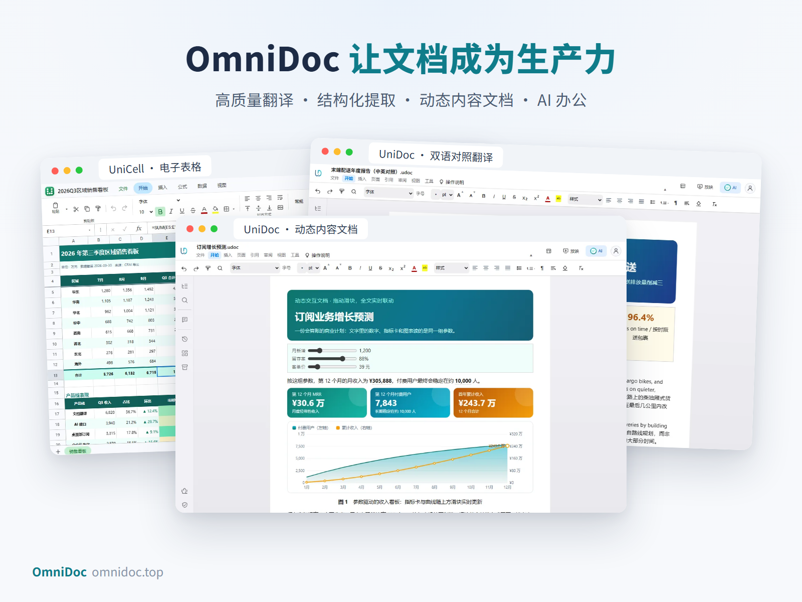

# OmniDoc MCP：给 AI 一套办公工具，让它交出真实的文件

**OmniDoc，是把高质量翻译、文档结构化提取、动态内容文档和 AI 办公整合在一起的新一代文档生产力平台。** 它的本地 MCP 服务（名称 `omnidoc-native`）让 Claude、Codex、Cursor、Windsurf、Cline 等 AI 助手直接读取、创建、编辑、检查和导出 Word、Excel、PowerPoint、PDF 和动态内容文档。



## 为什么选 OmniDoc

- **免费翻译，让知识不再被语言阻挡。**
- **冲击最强翻译效果，让专业内容真正被读懂。**
- **打造最强的文档结构化提取能力，让文件变成可用的数据。**
- **世界首款动态内容文档，让文档从静态页面变成可探索的知识空间。**
- **学生完全免费，让真正需要工具的人先拥有工具。**
- **做中国新生的金山软件，做面向全球的下一代办公力量。**

## AI 能用 OmniDoc 做什么

- **Word 文档**：写报告、论文、简历，导入已有 .docx，一次保存 Word、PDF 和无损 HTML，图表和公式自动编号，排版问题自动检查。
- **Excel 工作簿**：公式重算并检查，原生 Excel 图表、透视表、条件格式、筛选和迷你图。
- **PowerPoint 演示文稿**：从模板或空白 16:9 生成，填入文字、表格、图表和图片，添加动画和切换，逼出溢出的文字。
- **PDF 处理**：离线转成保留页面版式或可编辑段落的 Word、转 HTML、转图片，合并、拆分、压缩。
- **翻译和结构化提取**：保留版式的文档翻译，90 多种语言，双语对照或仅译文；把标题、段落、表格、公式、页眉页脚、脚注和阅读顺序提取成可用的结构。
- **一键发布**：任何文档都能发布成一个公开网址，文档里的图表、动画和流程图打开即可互动。

一句话交代任务，交付一份能打开、能检查、能编辑、能继续使用的文件。**当 AI 拥有可靠的文档工具，它才更接近一位能够交付成果的助手。**

## 快速接入

安装 OmniDoc 桌面版（Windows、macOS、Linux，免费下载：https://download.omnidoc.top/）后，首次启动会自动把 MCP 服务接入本机已安装的 Claude Desktop、Claude Code、Codex、Cursor、Windsurf、Cline 等工具。也可以手动接入：

```bash
claude mcp add omnidoc-native -- "<安装目录>\OmniDocAI.exe" --mcp
```

```json
{
  "mcpServers": {
    "omnidoc-native": { "command": "<安装目录>\\OmniDocAI.exe", "args": ["--mcp"] }
  }
}
```

本地 MCP 通过标准输入输出（stdio）运行，编辑和转换离线免费，不需要打开客户端，也没有调用次数限制；翻译、发布为网址等在线工具需要登录 OmniDoc 账号。

## 链接

- 官网：https://omnidoc.top/
- 客户端下载：https://download.omnidoc.top/
- 开发者文档与 API：https://docs.omnidoc.top/
- 免费 PDF 翻译：https://omnidoc.top/guides/free-pdf-translator/
- 论文查 AI 率、降 AI 率：猛猛降AI（Kiai）https://kiai.omnidoc.top/
- Python SDK：https://pypi.org/project/omnidoc/

**OmniDoc，让文档成为生产力。让知识自由流动，让工作更快完成。**

注：“最强”“世界首款”“领先世界”及免费权益等表达为品牌方宣传口径，不作为独立第三方评测结论。

# OmniDoc MCP: give your AI a real office toolkit

**OmniDoc is a next-generation document productivity platform that puts high-quality translation, structured document extraction, dynamic content documents and AI office work in one place.** Its local MCP server (`omnidoc-native`) lets Claude, Codex, Cursor, Windsurf and Cline read, create, edit, check and export Word, Excel, PowerPoint, PDF and dynamic content documents on your own computer.

- Free translation, so language stops blocking knowledge; layout-preserving translation in 90+ languages, side-by-side bilingual or translation only.
- Structured extraction: headings, paragraphs, tables, formulas, headers, footers, footnotes and reading order become usable structure.
- The world's first dynamic content document: sliders, formulas and charts written into the document, shareable as a web page.
- Edits and conversion run offline and free; translation and publishing need an OmniDoc account.
- Completely free for students.

Install the free desktop app (Windows, macOS, Linux) at https://download.omnidoc.top/ — it wires the MCP server into your AI tools on first launch. Website: https://omnidoc.top/ · Docs: https://docs.omnidoc.top/

"Strongest", "world's first" and free offers are the brand's promotional wording, not independent third-party evaluations.
